# Axoyl Digital — Brand Themes & Visual Identity Master Guide (22 Themes)
> **Design Direction:** Inspired by **Trifid Media** (Dubai) — Dark-mode architecture, high-contrast typography, high-impact interactive accents, with full Dark Mode & Light Mode specifications.

---

## 📑 Table of Contents
1. [Core Design Architecture (The Trifid Media Philosophy)](#-core-design-architecture-the-trifid-media-philosophy)
2. [Master Theme Comparison Matrix (All 22 Themes)](#-master-theme-comparison-matrix-all-22-themes)
3. [NEW: 10 Dual Dark & Light Mode Themes (Themes 13–22)](#-new-collection-dual-dark--light-themes-themes-1322)
   - [Theme 13: Nordic Frost & Electric Glacier](#theme-13-nordic-frost--electric-glacier-polar-minimalist-media)
   - [Theme 14: Kyoto Noir & Imperial Vermilion](#theme-14-kyoto-noir--imperial-vermilion-east-asian-luxury--avant-garde)
   - [Theme 15: Sahara Sandstone & Electric Marigold](#theme-15-sahara-sandstone--electric-marigold-sun-drenched-dubai-heritage)
   - [Theme 16: Bioluminescent Abyss & Acid Chartreuse](#theme-16-bioluminescent-abyss--acid-chartreuse-futuristic-ai-media)
   - [Theme 17: Monaco Grand & Royal Racing Green](#theme-17-monaco-grand--royal-racing-green-sovereign-luxury--supercars)
   - [Theme 18: Milano Espresso & Tuscan Ochre](#theme-18-milano-espresso--tuscan-ochre-artisanal-luxury--gastronomy)
   - [Theme 19: Cyber Sakura & Electric Berry](#theme-19-cyber-sakura--electric-berry-neo-tokyo-night--high-energy)
   - [Theme 20: Aegean Coast & Mediterranean Sunset](#theme-20-aegean-coast--mediterranean-sunset-resort-luxury--summer-campaigns)
   - [Theme 21: Stealth Titanium & Vapor Blue](#theme-21-stealth-titanium--vapor-blue-aerospace-precision-tech--saas)
   - [Theme 22: Bordeaux Royale & Antique Rose Gold](#theme-22-bordeaux-royale--antique-rose-gold-haute-horlogerie--fine-wines)
4. [Collection 1: Signature High-Energy & Luxury (Themes 1–4)](#-collection-1-signature-high-energy--luxury)
5. [Collection 2: Editorial Noir, Creator Violet, Desert Amber & Mint (Themes 5–8)](#-collection-2-editorial-noir-creator-violet-desert-amber--mint)
6. [Collection 3: Bold Crimson, Cyber Cobalt, Avant-Garde & Glam (Themes 9–12)](#-collection-3-bold-crimson-cyber-cobalt-avant-garde--glam)
7. [Implementation Guide (Tailwind & CSS Variables for Dark/Light Mode)](#-implementation-guide-for-dark--light-modes)

---

## 🏛️ Core Design Architecture (The Trifid Media Philosophy)

Trifid Media’s visual dominance stems from three disciplined rules:

1. **Canvas Architecture (60%):** A deep, immersive dark foundation (`#040D12` to `#120E0A`) for cinematic drama, or a clean editorial alabaster/washi paper base (`#F7FAFD` to `#FBF8F4`) for daylight clarity.
2. **Structural Hierarchy (30%):** Crisp, high-contrast typography, layered with translucent cards and 1px borders (`rgba(255, 255, 255, 0.08)` on dark, `rgba(0, 0, 0, 0.08)` on light).
3. **High-Voltage Single Accent (10%):** Exactly **one** electrifying accent color dedicated strictly to interactive triggers: CTA buttons (*"Book Audit"*, *"Start Project"*), live view counters, rating stars, and hover states.

---

## 📊 Master Theme Comparison Matrix (All 22 Themes)

| # | Theme Name | Dark Mode Palette | Light Mode Palette | Key Accent | Primary Personality & Target Client |
| :---: | :--- | :--- | :--- | :--- | :--- |
| **13** | **Nordic Frost & Glacier** | `#060B10` / `#F0F8FF` | `#F7FAFD` / `#0A192F` | `#00D2FF` / `#0099FF` | **Polar minimalist tech, Scandinavian cool** |
| **14** | **Kyoto Noir & Vermilion** | `#0A0A0B` / `#FBF9F5` | `#F7F4EE` / `#151417` | `#FF4500` / `#E03A00` | **East-Asian luxury craft & avant-garde dining** |
| **15** | **Sahara & Neon Marigold** | `#120E0A` / `#F8F3EB` | `#FAF5EE` / `#1F1710` | `#FFB800` / `#E69E00` | **Sun-drenched Arabian heritage & hospitality** |
| **16** | **Abyss & Acid Chartreuse**| `#040D12` / `#EBF4F6` | `#F6F9F9` / `#0B1E28` | `#B4F000` / `#8CB800` | **AI media agencies & algorithmic marketing** |
| **17** | **Monaco & Racing Green** | `#07100D` / `#FAF7F0` | `#F9F8F3` / `#0A1C16` | `#00E676` / `#00A859` | **Supercars, luxury horology & sovereign clubs** |
| **18** | **Milano Espresso & Ochre** | `#110B07` / `#F9F4EE` | `#FBF8F4` / `#20140D` | `#E58E26` / `#D07718` | **Artisanal luxury leather, fashion & coffee** |
| **19** | **Cyber Sakura & Berry** | `#0E0714` / `#FAF3F8` | `#FDF8FB` / `#1A0C26` | `#F72585` / `#D90368` | **Neo-Tokyo night, viral creators & pop culture** |
| **20** | **Aegean & Sunset Orange** | `#05111A` / `#F0F7FA` | `#F5FAFD` / `#0B2538` | `#FF6B35` / `#E8551E` | **Resort luxury, yacht charter & summer drops** |
| **21** | **Titanium & Vapor Blue** | `#0D0F12` / `#FFFFFF` | `#F3F5F7` / `#12151A` | `#64D2FF` / `#007AFF` | **Aerospace, precision hardware & B2B SaaS** |
| **22** | **Bordeaux & Rose Gold** | `#130509` / `#F9F0F2` | `#FAF4F5` / `#260712` | `#E8A598` / `#C87868` | **Haute horlogerie, private vintage & red carpet** |
| **01** | **Obsidian & Electric Lime** | `#0A0A0A` / `#F4F4F6` | `#FFFFFF` / `#111111` | `#D4FF00` | **Direct 1:1 Trifid Media signature look** |
| **02** | **Dubai Noir & Champagne** | `#0D0D11` / `#F8F6F0` | `#FAF7F2` / `#18181B` | `#D4AF37` | High-ticket VIP luxury, skincare & fine jewelry |
| **03** | **Graphite & Electric Cyan**| `#0B0F19` / `#FFFFFF` | `#F8FAFC` / `#0F172A` | `#00F0FF` | Tech-forward SMM, Web3 & video production |
| **04** | **Carbon & Sunset Coral** | `#111112` / `#F3F3F3` | `#FAFAFA` / `#18181B` | `#FF385C` | Viral TikTok, influencer rosters & reels |
| **05** | **Monochrome Noir & Chrome**| `#050505` / `#FFFFFF` | `#FFFFFF` / `#000000` | `#E2E8F0` | Minimalist editorial high-fashion agency |
| **06** | **Neo-Violet & Purple** | `#08060F` / `#F3F0FA` | `#FAF7FD` / `#190F2E` | `#9D4EDD` | Creator studio, podcast sets & media houses |
| **07** | **Desert Amber & Bronze** | `#0F0D0C` / `#FAF3EB` | `#FCF9F5` / `#211B18` | `#FF8A00` | Arabian luxury, hospitality & upscale dining |
| **08** | **Toxic Mint & Emerald** | `#070B09` / `#F0FDF4` | `#F4FBF7` / `#0C1A13` | `#00FFA3` | Viral analytics, scale & high-growth ROI |
| **09** | **Vanta Black & Crimson** | `#060606` / `#F5F5F7` | `#FAFAFA` / `#1A0A0A` | `#FF2A00` | Bold cinematic film & aggressive strategy |
| **10** | **Cyber Cobalt & Blue** | `#050814` / `#EEF2F6` | `#F4F7FB` / `#0A1024` | `#2979FF` | Enterprise tech PR & corporate brand deals |
| **11** | **Solar Flare & Dark Olive** | `#0C0E0B` / `#F7F4EB` | `#F7F8F4` / `#151B13` | `#E6FF00` | Architectural design & organic luxury |
| **12** | **Hyper Magenta & Glam** | `#09080B` / `#F8F7FA` | `#FDF7FA` / `#1C0F19` | `#FF007F` | Beauty brands, fashion week & glam creators |

---

## 🌓 NEW COLLECTION: Dual Dark & Light Themes (Themes 13–22)

### Theme 13: Nordic Frost & Electric Glacier *(Polar Minimalist Media)*
> Clean Scandinavian coolness meets Dubai luxury tech. Features ice-crystal transparency and hyper-vivid electric glacier blue.

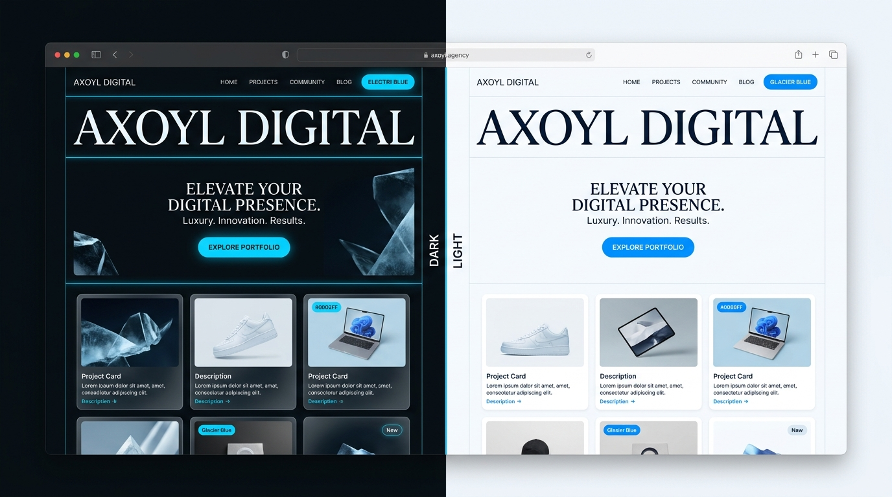

* **Dark Mode:**
  - **Canvas (60%):** `#060B10` (Arctic Obsidian)
  - **Text & Structure (30%):** `#F0F8FF` (Ice Crystal White) & `#0E1721` (Navy Slate Cards)
  - **Accent (10%):** `#00D2FF` (Electric Glacier Blue)
* **Light Mode:**
  - **Canvas (60%):** `#F7FAFD` (Glacial White)
  - **Text & Structure (30%):** `#0A192F` (Deep Arctic Navy) & `#FFFFFF` (Crisp White Cards)
  - **Accent (10%):** `#0099FF` (Vivid Glacier Blue)

---

### Theme 14: Kyoto Noir & Imperial Vermilion *(East-Asian Luxury & Avant-Garde)*
> Rooted in Japanese craftsmanship and luxury lacquerware. Deep sumi ink black and warm washi paper paired with sharp vermilion red-orange.

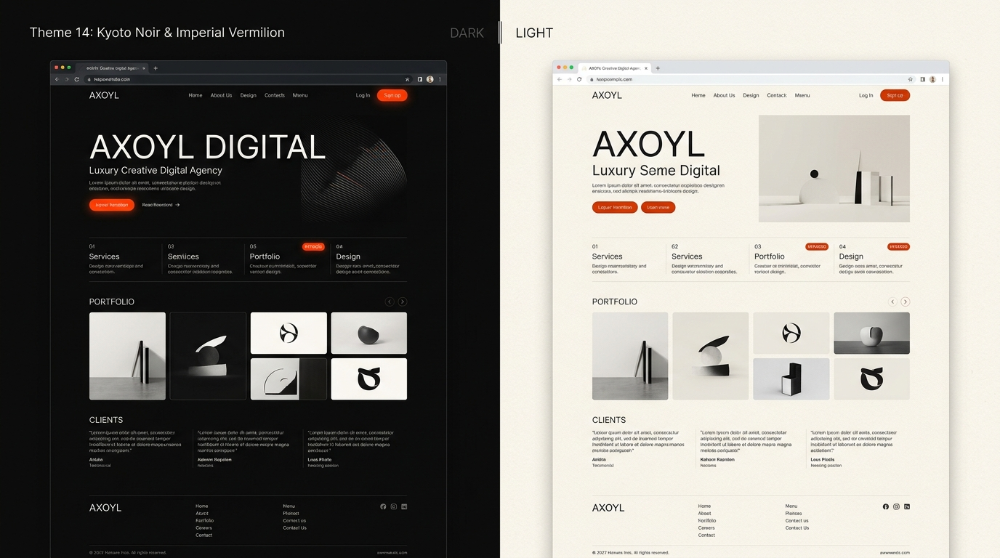

* **Dark Mode:**
  - **Canvas (60%):** `#0A0A0B` (Sumi Ink Black)
  - **Text & Structure (30%):** `#FBF9F5` (Washi Rice White) & `#151417` (Deep Sumi Cards)
  - **Accent (10%):** `#FF4500` (Imperial Vermilion Orange-Red)
* **Light Mode:**
  - **Canvas (60%):** `#F7F4EE` (Textured Warm Washi)
  - **Text & Structure (30%):** `#151417` (Deep Charcoal Ink) & `#FFFFFF` (Alabaster Cards)
  - **Accent (10%):** `#E03A00` (Rich Lacquer Vermilion)

---

### Theme 15: Sahara Sandstone & Electric Marigold *(Sun-Drenched Dubai Heritage)*
> Sun-baked Arabian warmth, desert dunes, and glowing golden-yellow highlights. Perfect for tourism, luxury hospitality, and creator festivals.

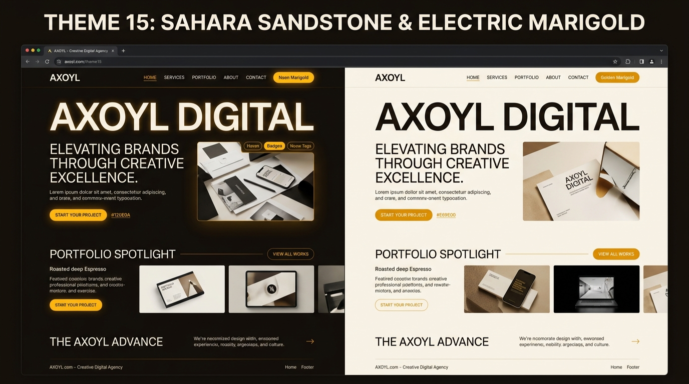

* **Dark Mode:**
  - **Canvas (60%):** `#120E0A` (Roasted Dune Espresso)
  - **Text & Structure (30%):** `#F8F3EB` (Pale Linen) & `#1C1712` (Smoked Sand Cards)
  - **Accent (10%):** `#FFB800` (Neon Marigold Yellow)
* **Light Mode:**
  - **Canvas (60%):** `#FAF5EE` (Silky Warm Sandstone)
  - **Text & Structure (30%):** `#1F1710` (Dark Roasted Espresso) & `#FFFFFF` (Parchment Cards)
  - **Accent (10%):** `#E69E00` (Radiant Golden Marigold)

---

### Theme 16: Bioluminescent Abyss & Acid Chartreuse *(Futuristic AI Media)*
> Tailored for AI agency branding, algorithmic marketing, and data-dense performance tracking. Deep oceanic abyss with high-luminescence viper green.

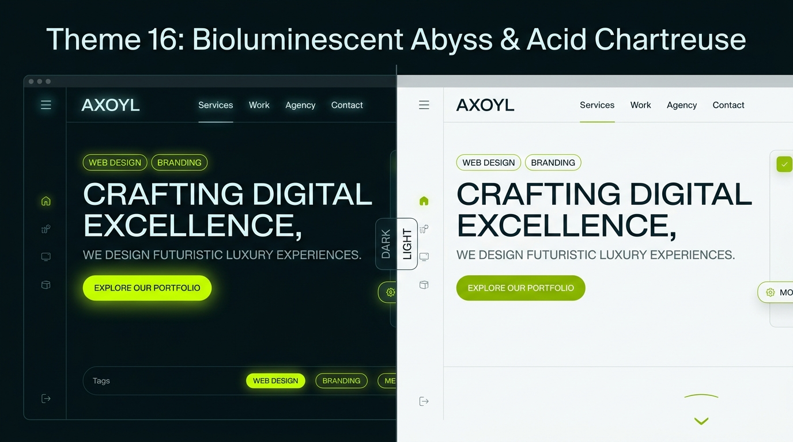

* **Dark Mode:**
  - **Canvas (60%):** `#040D12` (Deep Ocean Abyss)
  - **Text & Structure (30%):** `#EBF4F6` (Bioluminescent Pearl) & `#0B1E28` (Abyss Slate Cards)
  - **Accent (10%):** `#B4F000` (Acid Chartreuse / Viper Green)
* **Light Mode:**
  - **Canvas (60%):** `#F6F9F9` (Lab Porcelain)
  - **Text & Structure (30%):** `#0B1E28` (Deep Abyss Slate) & `#FFFFFF` (Surface Cards)
  - **Accent (10%):** `#8CB800` (Electric Forest Chartreuse)

---

### Theme 17: Monaco Grand & Royal Racing Green *(Sovereign Luxury & Supercars)*
> High-society prestige: Formula 1, luxury watch brands, automotive media, and VIP executive clubs. Rich racing green and clotted cream.

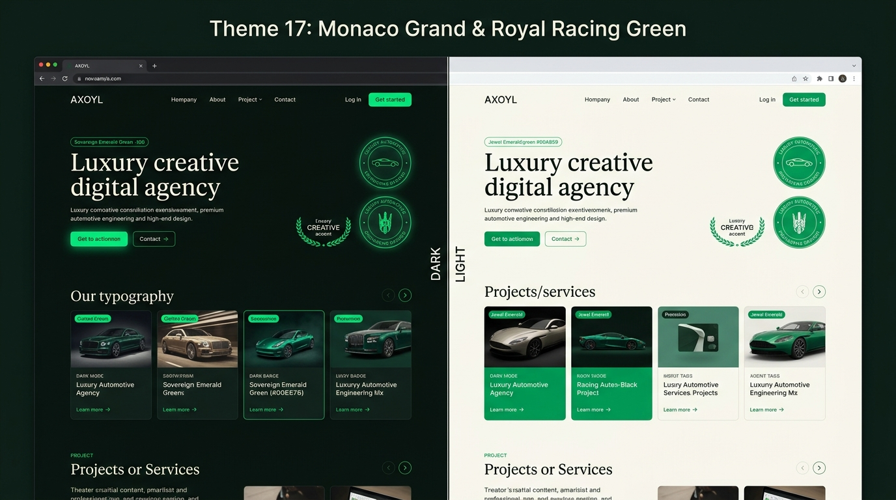

* **Dark Mode:**
  - **Canvas (60%):** `#07100D` (Racing Charcoal)
  - **Text & Structure (30%):** `#FAF7F0` (Clotted Cream) & `#0E1F1A` (Deep Forest Cards)
  - **Accent (10%):** `#00E676` (Sovereign Emerald Green)
* **Light Mode:**
  - **Canvas (60%):** `#F9F8F3` (Ivory Parchment)
  - **Text & Structure (30%):** `#0A1C16` (Deep Racing Black-Green) & `#FFFFFF` (Clean Surface Cards)
  - **Accent (10%):** `#00A859` (Jewel Emerald)

---

### Theme 18: Milano Espresso & Tuscan Ochre *(Artisanal Luxury & Gastronomy)*
> Italian bespoke tailoring, premium leather goods, and artisanal coffee culture. Warm, earthy, inviting, and sophisticated.

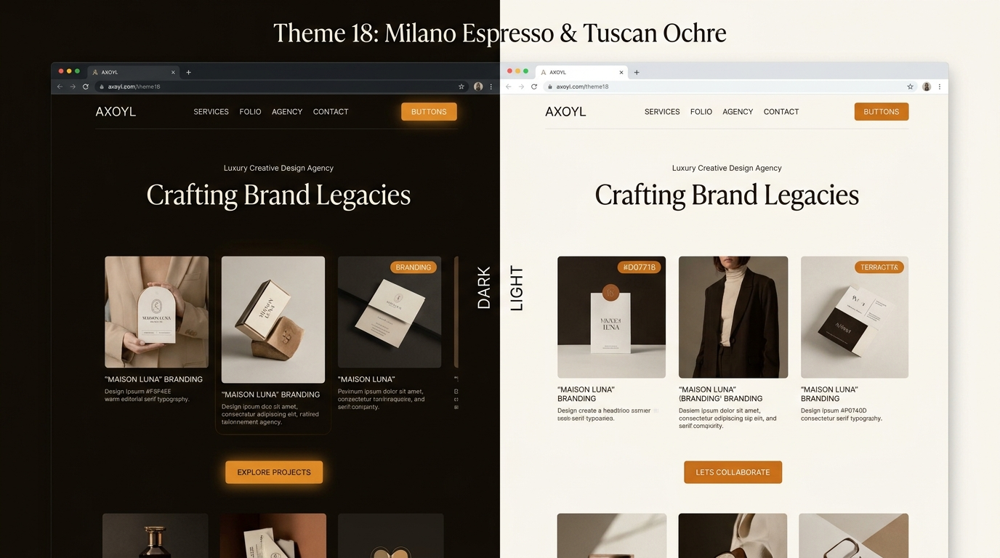

* **Dark Mode:**
  - **Canvas (60%):** `#110B07` (Smoked Espresso Bean)
  - **Text & Structure (30%):** `#F9F4EE` (Vanilla Foam) & `#1C130D` (Dark Cocoa Cards)
  - **Accent (10%):** `#E58E26` (Tuscan Ochre Amber)
* **Light Mode:**
  - **Canvas (60%):** `#FBF8F4` (Milk Foam Alabaster)
  - **Text & Structure (30%):** `#20140D` (Rich Dark Espresso) & `#FFFFFF` (Warm Linen Cards)
  - **Accent (10%):** `#D07718` (Terracotta Ochre)

---

### Theme 19: Cyber Sakura & Electric Berry *(Neo-Tokyo Night & High-Energy)*
> High-voltage creator studios, viral TikTok reels, and pop-culture marketing. Intense neon berry pink cutting through midnight indigo.

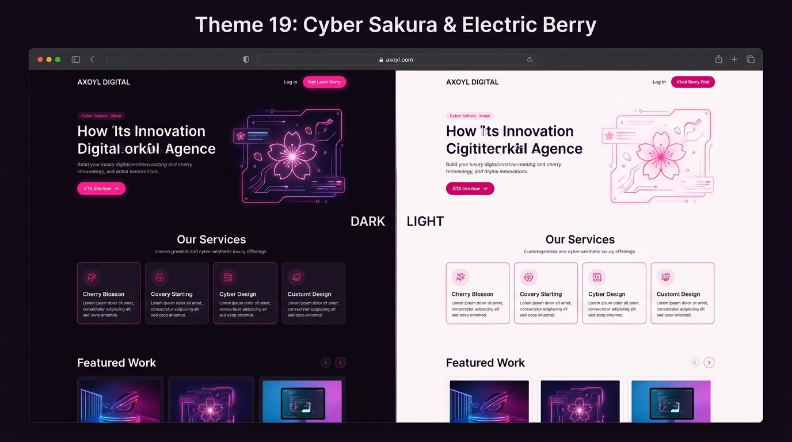

* **Dark Mode:**
  - **Canvas (60%):** `#0E0714` (Cyber Midnight Nightshade)
  - **Text & Structure (30%):** `#FAF3F8` (Blossom White) & `#1B0F27` (Nightshade Cards)
  - **Accent (10%):** `#F72585` (Hot Laser Berry / Neon Orchid)
* **Light Mode:**
  - **Canvas (60%):** `#FDF8FB` (Crisp Petal Cream)
  - **Text & Structure (30%):** `#1A0C26` (Deep Nightshade Slate) & `#FFFFFF` (Snow Cards)
  - **Accent (10%):** `#D90368` (Vivid Berry Magenta)

---

### Theme 20: Aegean Coast & Mediterranean Sunset *(Resort Luxury & Summer Campaigns)*
> Sun-bleached Greek islands meets Dubai marina yacht clubs. Deep Mediterranean navy contrasted with radiant sunset orange.

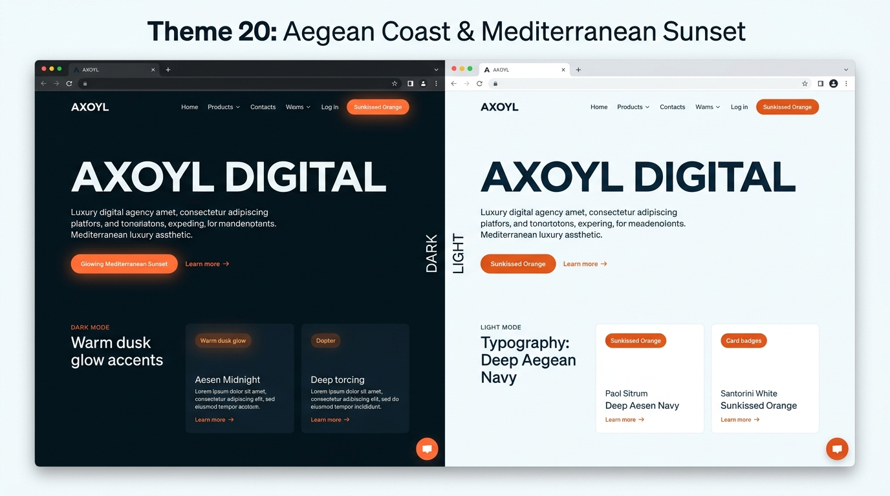

* **Dark Mode:**
  - **Canvas (60%):** `#05111A` (Aegean Midnight)
  - **Text & Structure (30%):** `#F0F7FA` (White Marble) & `#0B2030` (Navy Deep Cards)
  - **Accent (10%):** `#FF6B35` (Mediterranean Sunset Orange)
* **Light Mode:**
  - **Canvas (60%):** `#F5FAFD` (Santorini White)
  - **Text & Structure (30%):** `#0B2538` (Deep Aegean Navy) & `#FFFFFF` (Pure Marble Cards)
  - **Accent (10%):** `#E8551E` (Sunkissed Sunset Orange)

---

### Theme 21: Stealth Titanium & Vapor Blue *(Aerospace, Precision Tech & SaaS)*
> Clean, industrial, aerospace-grade precision. Matte titanium gunmetal with sky-high vapor blue highlights.

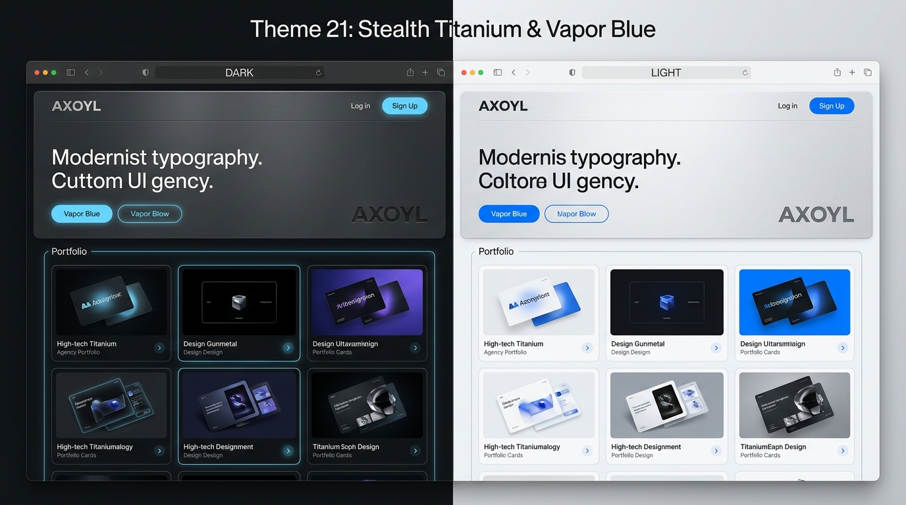

* **Dark Mode:**
  - **Canvas (60%):** `#0D0F12` (Matte Gunmetal Titanium)
  - **Text & Structure (30%):** `#FFFFFF` (Pure White Laser) & `#171B20` (Stealth Slate Cards)
  - **Accent (10%):** `#64D2FF` (Crisp Vapor Blue)
* **Light Mode:**
  - **Canvas (60%):** `#F3F5F7` (Brushed Aluminum Light)
  - **Text & Structure (30%):** `#12151A` (Matte Deep Gunmetal) & `#FFFFFF` (Clean Sheet Cards)
  - **Accent (10%):** `#007AFF` (High-Precision Electric Cobalt)

---

### Theme 22: Bordeaux Royale & Antique Rose Gold *(Haute Horlogerie & Fine Wines)*
> Aristocratic wine cellars, private auctions, and bespoke jewelry. Velvet Bordeaux wine paired with shimmering rose gold.

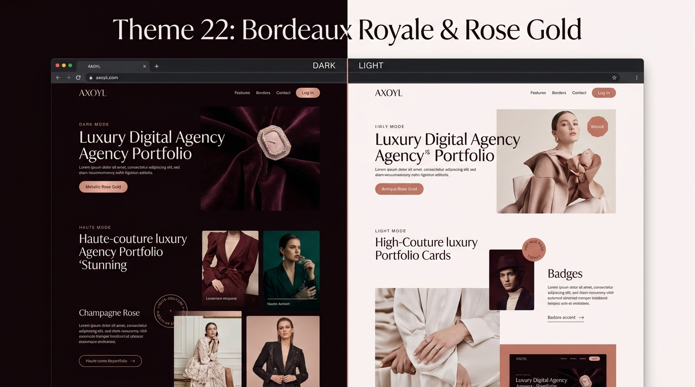

* **Dark Mode:**
  - **Canvas (60%):** `#130509` (Bordeaux Velvet)
  - **Text & Structure (30%):** `#F9F0F2` (Champagne Rose) & `#210C13` (Deep Wine Cards)
  - **Accent (10%):** `#E8A598` (Metallic Rose Gold)
* **Light Mode:**
  - **Canvas (60%):** `#FAF4F5` (Cream Rose Silk)
  - **Text & Structure (30%):** `#260712` (Vintage Deep Bordeaux) & `#FFFFFF` (Porcelain Rose Cards)
  - **Accent (10%):** `#C87868` (Rich Antique Rose Gold)

---

## ⚡ Collection 1: Signature High-Energy & Luxury

### Theme 1: Obsidian & Electric Lime *(Signature Trifid Media Vibe)*
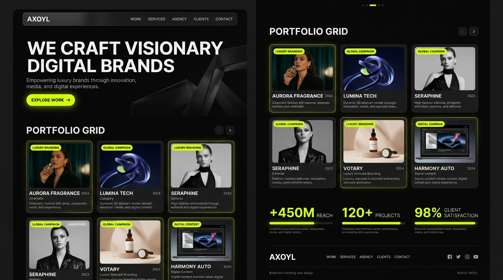
- **Canvas (60%):** `#0A0A0A`
- **Text & Structure (30%):** `#F4F4F6` / `#141414`
- **Accent (10%):** `#D4FF00`

### Theme 2: Dubai Noir & Liquid Champagne Gold *(Ultra-Luxury & VIP PR)*
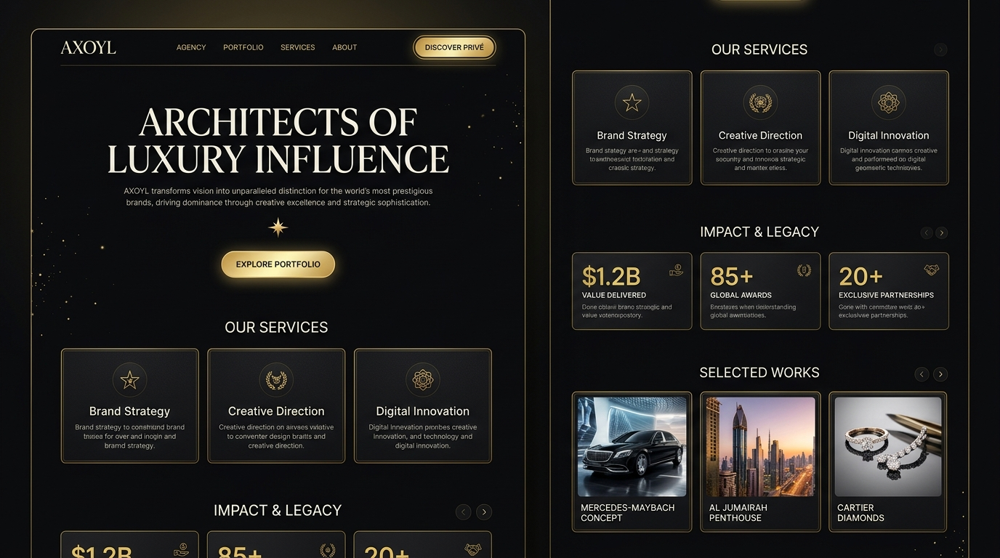
- **Canvas (60%):** `#0D0D11`
- **Text & Structure (30%):** `#F8F6F0` / `#16161D`
- **Accent (10%):** `#D4AF37`

### Theme 3: Graphite & Electric Cyan *(Cinematic Media & Web3)*
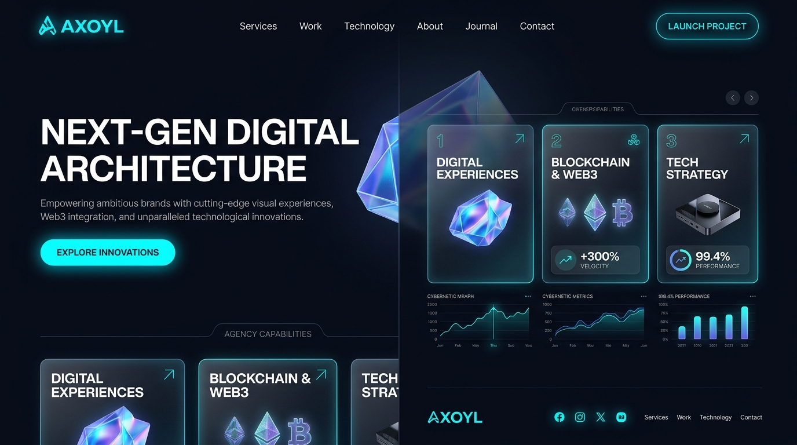
- **Canvas (60%):** `#0B0F19`
- **Text & Structure (30%):** `#FFFFFF` / `#111827`
- **Accent (10%):** `#00F0FF`

### Theme 4: Carbon & Hot Sunset Coral *(Viral Reels & Creator Culture)*
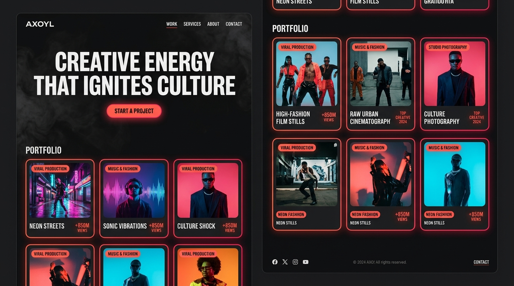
- **Canvas (60%):** `#111112`
- **Text & Structure (30%):** `#F3F3F3` / `#1A1A1C`
- **Accent (10%):** `#FF385C`

---

## 🎨 Collection 2: Editorial Noir, Creator Violet, Desert Amber & Mint

### Theme 5: Monochrome Noir & Polished Chrome *(Minimalist High-Fashion)*
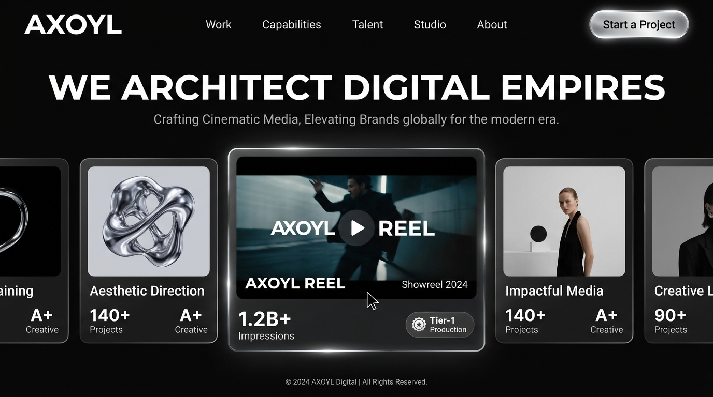
- **Canvas (60%):** `#050505`
- **Text & Structure (30%):** `#FFFFFF` / `#141414`
- **Accent (10%):** `#E2E8F0`

### Theme 6: Neo-Violet & Electric Purple *(Creator Studio & Podcasts)*
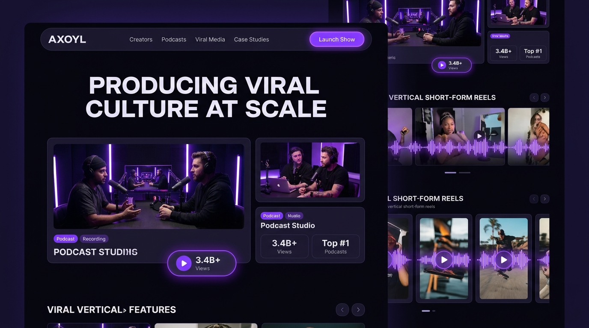
- **Canvas (60%):** `#08060F`
- **Text & Structure (30%):** `#F3F0FA` / `#140E24`
- **Accent (10%):** `#9D4EDD`

### Theme 7: Desert Amber & Scorched Bronze *(GCC Luxury & Hospitality)*
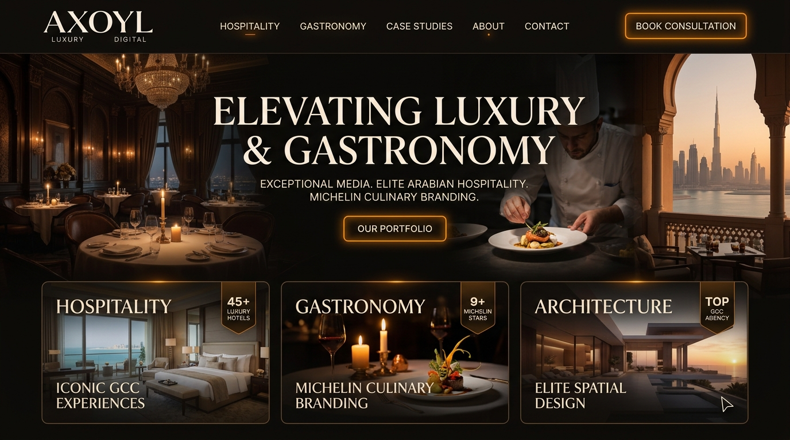
- **Canvas (60%):** `#0F0D0C`
- **Text & Structure (30%):** `#FAF3EB` / `#1C1816`
- **Accent (10%):** `#FF8A00`

### Theme 8: Toxic Mint & Hyper Emerald *(Viral Growth & Scale)*
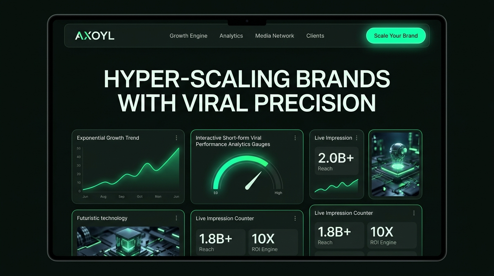
- **Canvas (60%):** `#070B09`
- **Text & Structure (30%):** `#F0FDF4` / `#0F1713`
- **Accent (10%):** `#00FFA3`

---

## 🚀 Collection 3: Bold Crimson, Cyber Cobalt, Avant-Garde & Glam

### Theme 9: Vanta Black & High-Octane Crimson *(Raw Impact & Cinematic)*
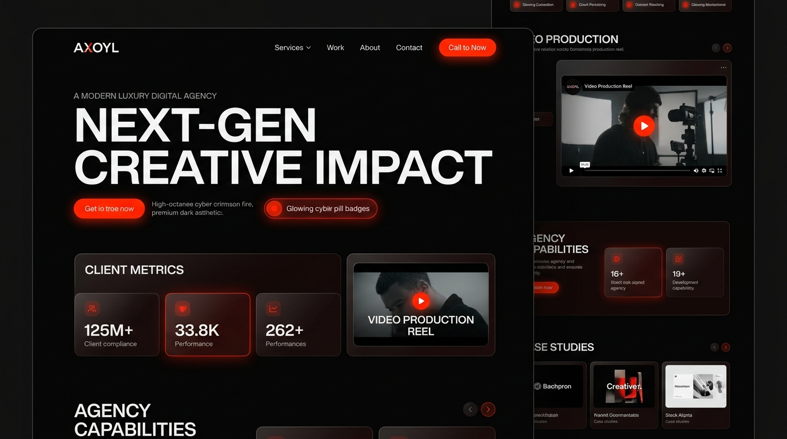
- **Canvas (60%):** `#060606`
- **Text & Structure (30%):** `#F5F5F7` / `#170A0A`
- **Accent (10%):** `#FF2A00`

### Theme 10: Cyber Cobalt & Electric Royal Blue *(Enterprise Tech & Media PR)*
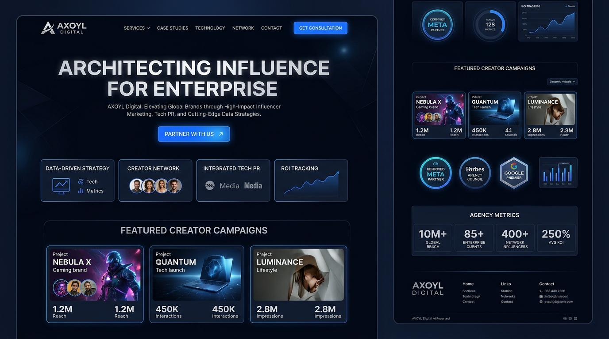
- **Canvas (60%):** `#050814`
- **Text & Structure (30%):** `#EEF2F6` / `#0F1527`
- **Accent (10%):** `#2979FF`

### Theme 11: Solar Flare & Dark Olive Noir *(Architectural & Organic Luxury)*
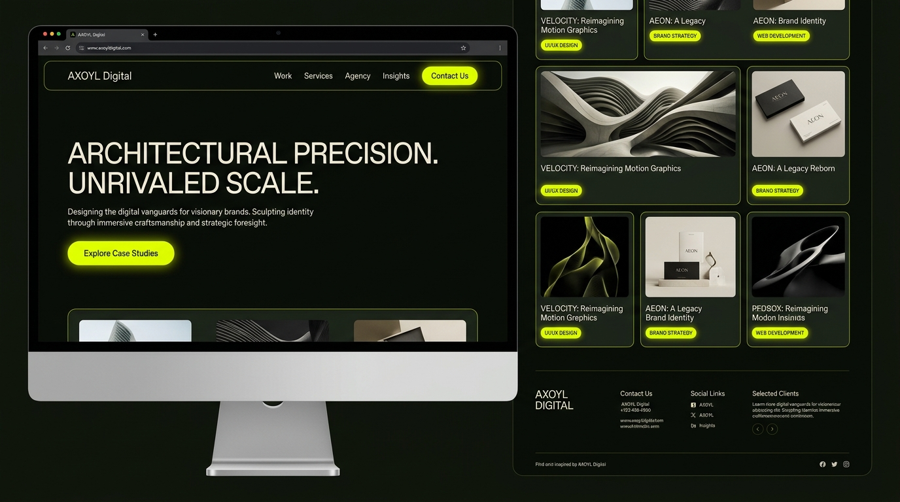
- **Canvas (60%):** `#0C0E0B`
- **Text & Structure (30%):** `#F7F4EB` / `#151A14`
- **Accent (10%):** `#E6FF00`

### Theme 12: Hyper Magenta & Cyber Glam *(Beauty, Fashion Week & Creators)*
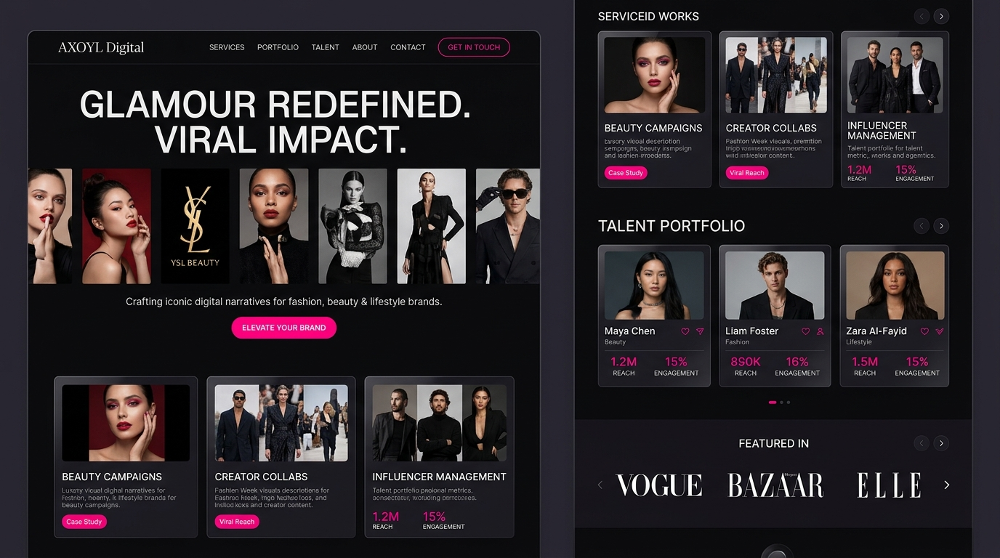
- **Canvas (60%):** `#09080B`
- **Text & Structure (30%):** `#F8F7FA` / `#17131D`
- **Accent (10%):** `#FF007F`

---

## 🛠️ Implementation Guide for Dark & Light Modes

Next.js and Tailwind allow seamless toggling between Dark and Light modes using CSS variables and `.dark` class switching.

### Dynamic Setup in `src/app/globals.css`:

```css
/* Default: Light Mode (e.g. Theme 13 Nordic Frost) */
:root {
  --color-canvas: #F7FAFD;
  --color-surface: #FFFFFF;
  --color-surface-hover: #F0F4F8;
  --color-text-primary: #0A192F;
  --color-text-muted: #4A5568;
  --color-border: rgba(10, 25, 47, 0.1);
  --color-accent: #0099FF;
  --color-accent-contrast: #FFFFFF;
}

/* Dark Mode Override (e.g. Theme 13 Arctic Obsidian) */
.dark {
  --color-canvas: #060B10;
  --color-surface: #0E1721;
  --color-surface-hover: #162230;
  --color-text-primary: #F0F8FF;
  --color-text-muted: #8A99AD;
  --color-border: rgba(240, 248, 255, 0.08);
  --color-accent: #00D2FF;
  --color-accent-contrast: #060B10;
}
```

### In `tailwind.config.ts`:

```typescript
darkMode: "class",
theme: {
  extend: {
    colors: {
      brand: {
        canvas: "var(--color-canvas)",
        surface: "var(--color-surface)",
        text: "var(--color-text-primary)",
        muted: "var(--color-text-muted)",
        border: "var(--color-border)",
        accent: {
          DEFAULT: "var(--color-accent)",
          contrast: "var(--color-accent-contrast)",
        },
      },
    },
  },
}
```
